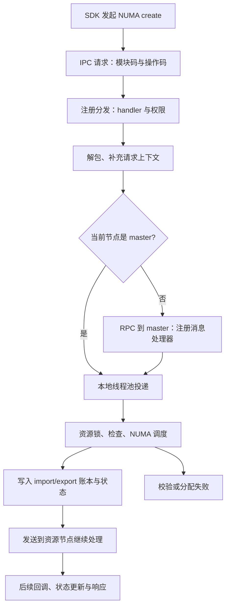

# 用 UBS Engine 检验大型仓库代码阅读工作台

2026-11-22。目标是帮助“懂代码、不熟悉该业务”的开发者建立主线、追踪状态变化和判断修改影响。结论：当前插件应优先完善仓库导航、协议/注册关系、执行上下文和资源实例，再扩展模拟执行；现有六视图可继续作为阅读界面。

## 1. 仓库来源与本轮范围

- 官方原仓：<https://atomgit.com/openeuler/ubs-engine>；openEuler 项目页将 UBS Engine 定位为 UB 计算系统的控制面核心参考实现：<https://www.openeuler.org/en/projects/ub-service-core/>。
- 本地：`E:/dsh/plugin/research/lingqu/ubs-engine`，浅克隆 `master`，提交 `0f8a279278433914c9bd1d4f3a2c3a40572cc40a`，提交时间 2026-11-20 15:55:06 +08:00。许可证 MulanPSL-2.0，保留完整上游文件。
- 插件对照基线：`52aacf936fe8aab8032a1c8dfc441b67dd21ab9b`。
- UBS Engine 是资源调度与服务控制面；UBM/UBFM 是其交互的下层组件。本轮没有找到并确认可直接下载的 UBM/UBFM 完整源码仓库，不用 UBS Engine 冒充底层 UBFM 实现。依据：上游 `docs/design/architecture.md` 的软件模块与外部依赖、`src/adapter_plugins/mti/`。
- 已做：官方来源核验、下载、Git 状态/版本核验、本地源码和构建描述阅读、规模统计、21 个源码锚点及哈希校验、独立只读复核。
- 未做：运行上游脚本、安装依赖、构建、单元测试、服务启动、Atlas 索引、真机操作。本报告是源码阅读与产品设计分析，不是索引精度或运行效果验收。

统计见 [metrics.json](../../evidence/ubs-engine-study/metrics.json)，版本与操作见 [source-lock.json](../../evidence/ubs-engine-study/source-lock.json)，锚点见 [source-facts.json](../../evidence/ubs-engine-study/source-facts.json)。复算：

```powershell
E:/Anaconda-main/python.exe evidence/ubs-engine-study/collect.py E:/dsh/plugin/research/lingqu/ubs-engine
```

Git 跟踪文件 2,449 个。按脚本列出的源码扩展名统计，`src/` 有 1,091 个源码/头文件、245,558 物理行，包含注释和空行；其中 `.cpp/.h/.c` 合计 1,005 个。`test/UT` 有 741 个代码文件、188,740 行。代码规模不是函数数或语义索引覆盖率。

| 生产代码区域 | 代码文件 | 物理行 | 阅读时要回答的问题 |
|---|---:|---:|---|
| `src/controllers` | 271 | 72,740 | 请求如何调度、分配、对账和迁移资源？ |
| `src/framework` | 173 | 32,984 | 模块、通信、线程、定时器、选举如何组织？ |
| `src/adapter_plugins` | 114 | 20,930 | 如何接到 OBMM、UBM 等外部能力？ |
| `src/sdk` | 49 | 11,652 | 外部开发者如何调用，谁分配和释放输出？ |
| `src/addons` | 391 | 92,122 | RMRS、VirtAgent、uCache 等怎样使用基础能力？ |

## 2. 面向新开发者的五层阅读主线

| 层 | 应先展示什么 | 本仓具体入口 | 对现有界面的调整 |
|---|---|---|---|
| 业务目标 | 管理哪些资源、创建/借用/归还/故障处理的结果是什么 | `docs/design/architecture.md`，SDK API 定义 | 增加仓库总览与业务术语，作为六视图共同入口 |
| 运行架构 | 哪些进程/库/模块存在，如何启动，谁依赖谁 | `src/CMakeLists.txt`、`scripts/rpm/ubse.service`、`UbseContext` | 由构建目标、模块注册、配置形成架构图；不要只按文件夹猜业务 |
| 一条业务流程 | 请求从哪来，经过哪种分发，在哪个节点/线程继续 | NUMA create 的 SDK→IPC→控制器→调度流程 | 端到端按业务任务展开，边类型明确，保留证据 |
| 状态与耦合 | 哪个资源实例的哪些字段被改，如何成功、失败、补偿 | debt ledger、import/export 对象、状态枚举、错误清理 | 资源变更链突出对象键、字段、状态、锁范围 |
| 具体实现 | 当前调用点、条件、类型、源码、测试是什么 | 具体方法及 `test/UT/mem_controller` | 文字树/文件视图承接细节，基础框架按需展开 |

文件主要职责应从编译目标、符号和证据归纳。上游 README 中部分路径拼写仍是 `apiserver/framwork`，实际源码为 `api_server/framework`；文档提供概念候选，当前源码提供定位事实，二者冲突应可见。

## 3. 已复核的 NUMA create 静态主线

这是一条经源码复核的分层阅读路径。`direct_call`、协议分发、RPC 与异步投递是不同的关系；不把它当成一次已经观测到的运行轨迹。

| 步骤 | 源码位置 | 应保留的事实 |
|---|---|---|
| SDK 输入与打包 | `src/sdk/c/ubs_engine_mem.cpp:343` | `name` 字符串、`size` 为 uint64、`distance` 枚举、`numa_desc` 输出指针；校验、申请、打包、解包和释放 |
| SDK 请求 | 同文件 `:373` | 调用 `ubse_invoke_call(UBSE_MEM, UBSE_MEM_NUMA_CREATE, …)` |
| 协议标识 | `src/framework/ipc/include/ubse_ipc_common.h:22,48`；`src/include/ubse_com_op_code.h:32,69` | 两端模块码 `0x0001`、操作码 `0x0010` 对应；二元键及所属协议都重要 |
| Handler 注册 | `src/controllers/mem/mem_controller/ubse_mem_controller_dispatcher.cpp:193` | `RegisterNumaSdkDispatcherCreate` 将二元键与 `UbseMemNumaCreateHandler`、`mem.numa` 权限关联 |
| IPC 间接分发 | `src/framework/ipc/server/ubse_ipc_server.cpp:60,71,108` | 注册表写入/读取及 `handler(requestBuffer, context)`；不是 SDK 对业务方法的直接调用 |
| 服务端解包 | `src/controllers/mem/mem_controller/ubse_mem_controller_dispatcher.cpp:1946` | `UbseMemNumaCreateReqUnpack`→`UbseMemNumaBorrowRpc`，保留 requestId |
| 主节点分支 | 同文件 `MemNumaBorrowRpc`，精确行见 source-facts | 非主节点：RPC 发往 master；本机为 master：`DoNumaBorrowAsync` |
| 异步继续 | `src/controllers/mem/mem_controller/ubse_mem_async_processor.cpp:149` | 向 `ubseMemController` 执行器投递 lambda；任务中调用 `UbseMemNumaBorrow` |
| 远端接收分支 | `src/controllers/mem/mem_controller/ubse_mem_rpc_processor.cpp:81,1011` | 注册 `UbseMemNumaBorrowMessageHandler`，Handle 中也经线程池进入借用逻辑 |
| 资源业务 | `src/controllers/mem/mem_controller/api/ubse_mem_controller_numa_api.cpp:319` | 派生资源锁键、校验/对账状态门禁、分配、写入账本、发送 export 对象、失败清理 |

可供首屏使用的抽象图：



图中 J/L 为本轮阅读的后续边界摘要；完整导出/导入、超时和每个响应出口仍需继续建立证据。`DoNumaBorrowAsync` 投递成功返回不等于资源已创建，必须把“请求接收”“投递成功”“资源完成”“响应完成”分开。

## 4. 以真实仓库为依据的改进清单

### CL-UBSE-01 仓库总览与问题导航，P0

**现状：** 当前从快照和入口函数开始；插件按直接调用数量选择默认入口，无法保证符合新人阅读主线。

**改进：** 在现有六视图上方提供仓库总览：业务目标→构建/运行单元→核心业务对象→典型流程→详细实现。首屏回答“我改 NUMA 调度、修改资源状态、排查 IPC 超时分别该去哪里”。分组名称同时保存代码依据、摘要和版本；技术分组与业务概念不要混为同一类。

**首验：** 无需了解目录即可找到 NUMA create 的 SDK、注册点、业务控制器、账本和相关 UT；所有入口可跳转。

### CL-UBSE-02 类型化关系图与注册/协议边，P0

**现状：** `client/model.cjs:60` 按被调函数去重，`resource-chains-model.js:23` 按入口/函数合并实例；静态时序图也只从函数调用表派生。IPC 和模板注册链无法仅凭这些边恢复。

**改进：** codegraph 保留 `contains/declares/direct_call/indirect_candidate/registers/dispatches/serializes/enqueues/rpc_send/rpc_receive/resource_access`。每条边有稳定身份、调用点/注册点、关系键、构建变体、证据来源和可信度。SDK 与 handler 用协议＋模块码＋操作码建立静态匹配，标为注册/协议证据，不升级为直接调用或已观测因果。

**首验：** 连通 `ubs_mem_numa_create`→`(0x1,0x10)`→`UbseMemNumaCreateHandler`，同时显示注册源码和 IPC map 的实际分发位置；同一操作码在其他模块不得误连。

### CL-UBSE-03 执行上下文与异步完成语义，P0

**现状：** `client/model.cjs:39` 缺省域为 kernel，资源链把非 library 显示为“内核态 / 示例”；资源链节点缺少进程、节点角色、线程池及 continuation 身份。

**本仓事实：** `scripts/rpm/ubse.service` 指定用户 `ubse` 并启动 `/usr/bin/ubse`；控制器使用线程池、RPC、requestId 和 TraceContext。它首先是用户态服务，外部库/内核/设备是进一步边界。

**改进：** 节点上下文至少包括程序/模块、用户态或内核态或未知、物理/逻辑节点角色、线程池、请求关联、调用实例。时序图按实际服务/节点/对象建立生命线；明确同步返回、异步接受和最终完成。traceId/requestId 是关联候选，只有实际观测匹配才画观测因果。

**首验：** master 本地和非 master 转发两条分支不混合；线程池投递用专用动作，保留后续任务；投递返回 0 不显示“内存创建成功”。

### CL-UBSE-04 共享资源从变量提升为类型与实例，P0

**现状：** 当前资源主要按声明对象和访问列表投影；源码补充只覆盖部分文件级 static。无法靠名称扫描可靠恢复单例、成员 map、模板类型实例和跨节点账本。

**本仓事实：** `UbseMemDebtLedger::GetInstance()` 的共享单例是函数局部 static；`GetDebtMap<T>()` 从 tuple 获取资源类型账本；`PutResource(nodeId,resId,obj)` 涉及节点与资源键。`UbseMemNodeDebtMap<T>::Modify` 用写时复制，而 `Update` 在写锁内执行读改写；不能统一标成一个“全局写”。

**改进：** 资源身份分为声明/类型、容器、符号化实例、字段路径、所有权和生命周期；例：`ledger<T=NUMA_IMPORT>[nodeId][resId].status.state`。未知实际键保持符号表达。区分本地临时对象字段赋值与通过 PutResource/UpdateResource 发布到共享账本的动作。容器 API 允许建立有证据的效果摘要，不能仅凭函数名猜读写。

**首验：** 选择某类 import/export 账本能看到初始化/查询/发布/更新/移除及关联函数；两个节点的同名资源不合并，NUMA/SHM 类型也不合并。

### CL-UBSE-05 RAII 与锁身份，P0

**本仓事实：** `logging_lock_guard.cpp:30,49,63` 中，锁从字符串键取得，构造时按 READ/WRITE 加锁、析构时解锁。NUMA 借用传 `GenerateExportObjKey(req.name,req.importNodeId)`；SHM 不同流程也使用名称或复合键，并可叠加 READ 锁。另有 `mutexMap` 的管理锁及账本自身的 shared_mutex，不能画成统一 name 的一把锁。

**改进：** 锁模型识别对象身份、符号键、模式、RAII 作用域、提前返回/异常析构边、锁别名与嵌套。锁覆盖属于调用实例和路径；没有 C++/别名/CFG 证据时保持未知。基础锁包装可折叠，但“获取何锁、何时释放、保护何对象”的摘要必须保留。

**首验：** `UbseMemNumaBorrow` 的多个提前返回也显示作用域释放；把导出业务锁、锁表管理锁和账本内部锁分别表达；不把原对象的 mutex 错当复制后对象的 mutex。

### CL-UBSE-06 真实参数、输出与结果合同，P0

**本仓事实：** `ubs_mem_numa_create` 具有字符串、uint64、枚举、输出结构指针；`ubs_mem_shm_create` 还有字节数组、位标志和结构指针。`src/sdk/c/include/ubs_error.h` 明确定义 `UBS_ERR_OPERATION_FAILED=42` 等正数错误码。插件 `lib/sim-worker.mjs:158` 目前用负数判断失败。

**改进：** 参数 schema 保留 ABI 类型、宽度、方向、单位、可空、长度关联、枚举/位标志、结构字段与对象引用；uint64 使用精确表示而非全部 JS number。接口结果合同单独描述成功码、错误枚举、返回对象及输出分配/释放责任。

**首验：** 能描述大于 4GiB 的 size、可空指针规则和输出 numa_desc；将 SDK 错误码 42 解释为失败。这里是对现有执行规则的静态反例，未运行 UBS Engine 或修改现有 runner。

### CL-UBSE-07 构建变体与 C++17 能力矩阵，P0

**事实：** CMake 要求 C11/C++17、导出编译数据库，按 ENABLE_UB 定义 UB_ENVIRONMENT；测试配置改变 ENABLE_UBSE_TESTING，生成 config.h/register_xalarm.h。module 注册宏还有场景条件。框架依赖 hcom、securec 等系统组件，外部 OBMM 动态载入。

**改进：** source-only 先建文件/构建目标/声明导航；拿到对应环境的 compile_commands、生成头、工具链后再建立编译语义关系。身份绑定 repo+commit+build target+variant+symbol+callsite；保留命名空间、方法重载、模板实例、lambda 和析构。没有构建环境时显示待解析边，不能把搜索结果补成确定调用。

**首验：** 同仓 COMMON/AI、ENABLE_UB 开关和 UT/生产变体不串图；列出哪些类型、调用和宏仍未解析。此次 C 源 Demo 的验收不证明 C++17 支持，亦不能据此断言 Atlas 不支持 C++。

### CL-UBSE-08 分层索引、查询与大图加载，P0

**现状：** `client/model.cjs:274` 预取前 100 个函数、每仓前 100 个文件、每文件 2000 行、前 24 个入口；当前仓库生产源文件远超过此限，已有生产文件超过 4000 行。读全部细节后才准备画图也不利于首次进入。

**改进：** 首屏只取目录/目标/模块统计和任务入口；源码、函数邻域、字段访问和调用实例分页/按需加载。缓存绑定源码与构建版本，变更只重算受影响派生关系；查询支持取消。节点/边分层聚合、文字树虚拟化、画布只渲染可见区域；达到预算显示剩余量和继续加载，不静默截断。

**首验：** 第 101 个文件和 2001 行后的符号可以搜索、读取、定位；首屏不等待全部函数/文件 RPC。延迟/内存预算应在此仓实测后设定，本轮不报未经测量的生成速度。

### CL-UBSE-09 基础组件效果摘要与业务状态/补偿，P1

**事实：** GetDebtMap/PutResource、序列化、IPC 发送、线程投递、锁包装是高复用组件，但对当前任务有重要副作用。NUMA API 的 HandleSendNumaExportError 移除/修正账本，SHM 也有状态检查、失败清理、迁移门禁和后续回调。

**改进：** 基础接口库归类依据可修改的合同，不以“叶子函数”或“没全局访问”决定业务无关。折叠后显示输入/输出、资源效果、异步行为、锁及失败语义。选中资源的效果不能因折叠消失。流程图表达分支/清理，另为同一资源提供状态转换投影，标明状态字段、前置条件、赋值动作和补偿入口。

**首验：** 读借用主线时默认隐藏序列化逐字段细节，但能看见谁申请/释放缓冲区、发布账本、发送命令、等待完成；失败分支能跳到账本清理和相关 UT。

### CL-UBSE-10 外部依赖、测试证据和变更影响，P1

**事实：** OBMM 由 dlopen/名称装载形成出口；本仓有 Python ctypes、Go cgo SDK，且 UT 中存在 mockcpp stub。真实例子要求 UB 硬件、运行中的 daemon 和多节点环境。

**改进：** 外部节点显示库/符号/ABI/已知版本及缺失实现，不把所有跨文件叶子当库；可配置分析到库出口或继续接入依赖仓。测试作为“输入、预置对象、mock 边界、期望结果”的阅读入口，不能把 mock 返回提升为设备事实。变更影响从字段、消息格式、opcode、调用点反向追到 SDK/绑定、控制器、账本、测试和配置，按关系证据给出确定影响/候选影响。

**首验：** 修改 size 或一项状态字段时能列出打包/解包、处理器、序列化及测试位置；在 libobmm 边界明确停止，或加载单独登记的依赖版本继续。首版先支持 source-guided 场景和现有 UT 解释，完整分布式模拟后置。

## 5. 对现有六视图的落实方式

| 视图 | 应适应本仓的变化 |
|---|---|
| 资源关系图 | 类型/容器定义实体唯一；可展开实例键，显示业务对象和共享账本的发布关系 |
| 文字树 | 保留调用点、注册点与源码条件；同一 helper 的多次调用独立；框架效果可折叠 |
| 端到端流程图 | SDK→协议→服务→master 分支→执行器→资源与响应；竖排正交实线，特殊交接用明确标签 |
| 时序图 | 调用进程、本地 daemon、master、export/import 节点及依赖服务按实例建生命线；区分静态与观测 |
| 文件视图 | 按构建目标/模块过滤、完整分页读取；C++17 类型、方法和跨语言绑定导航，而不只是配色 |
| 资源变更链 | 以类型＋节点/资源键＋字段聚合变化；锁模式、RAII 作用域和异步状态更新分开表达 |

所有视图选择共享稳定的符号、调用点、关系与资源实例引用，不能只同步函数名。仓库总览/业务任务是共同上层导航，不复制六份互相不一致的流程模型。

## 6. 建议先落地的验收切片

首个切片选 **NUMA create 静态阅读**：从 SDK 精确签名进入，连通 IPC 注册/分发、master 分支与两种线程入口，到 UbseMemNumaBorrow、关键账本和失败清理。暂不执行完整分布式业务。

1. 输入：本报告锁定的源码版本；无构建语义处显示 source-only/未知。
2. 交付：一页仓库总览、一条可折叠文字主线、局部端到端/资源链，并复用现有文件视图跳转。
3. 正确性门槛：不得把协议边称为直接调用；不得把投递成功称为创建完成；不得把同名不同节点/类型的资源合并；不得丢失 uint64/输出指针或正数错误码；缺失依赖和覆盖范围显式呈现。
4. 再扩展：SHM 的 RAII 多锁/状态回调、UT 场景、跨语言绑定与修改影响；最后才是运行适配和多节点观测。

这是对下一版实施顺序的建议，不代表这些能力已经实现或验收。下载与源码证据已完成，语义索引质量、布局性能、开发者理解效率和真实运行仍需各自验证。
